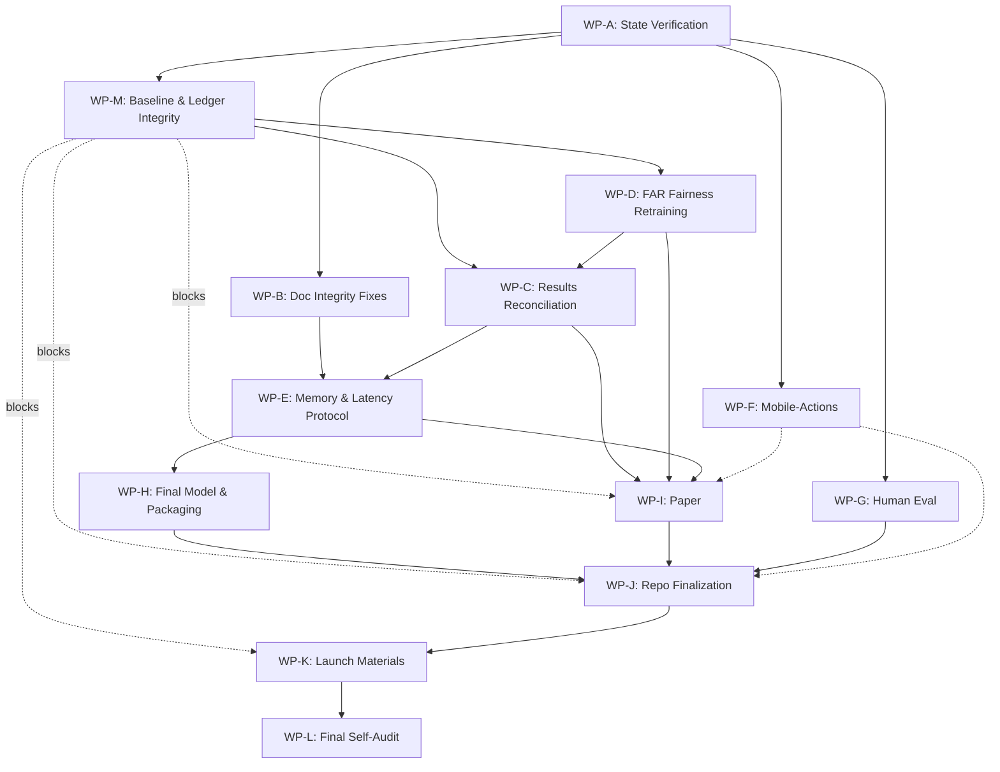

# ARN Implementation Plan — Post-Phase-16 Completion

**Date:** 2026-10-19
**Status:** PLAN (read-only — no code changes made)
**Prerequisite:** Read `STATE_RECONSTRUCTION.md` first.

---

## 1. Objective & Definition of Done

**Objective:** Complete the ARN project to a state where every number is traceable, every claim is defensible, every document is internally consistent, and the repository is ready for honest public release as a preprint and open-source artifact.

**Definition of Done (all must pass):**
1. Zero occurrences of "4.21 MB" (or any banned claim) in any tracked file
2. One single SD value per metric per model, sourced from `master_protocol_summary.json`
3. FAR fairness results either properly integrated or declared pending, never mixed with old results
4. Decoder ablation numbers reconciled and explained relative to master table
5. Multi-tool count = 1,132 (verified) used consistently; 114 = one pair clearly labeled
6. Pre-registration language accurately describes same-session protocol locking
7. Paper files renamed from AAAI template names; no AAAI-specific residue in public tree
8. ARN-public exported OUTSIDE the Aether directory tree
9. Git identity uses GitHub noreply email
10. All 26+ tests pass in a fresh venv
11. `scripts/audit_paper_numbers.py` passes
12. Banned-claims grep returns 0 hits
13. FINAL_REPORT free of promotional language
14. Launch drafts use only verified ledger numbers
15. Human evaluation documented as PENDING with correct methodology description

---

## 2. Work Package Dependency Graph



**Critical Path:** A → M → D → C → E → I → J → K → L

**Crucial Gate:** WP-M blocks WP-I (paper), WP-J (README), and WP-K (launch) until the TF-IDF LogReg baseline audit and decision tree are resolved.

---

## 3. Work Package Specifications

### WP-A: State Verification & Decision

**Goal:** Confirm the state reconstruction is accurate; decide on Phase 16 salvage.

**Size:** Small (1 session, ~30 min)

**Inputs:**
- `STATE_RECONSTRUCTION.md` (this plan)
- `STATE.md`, `DECISIONS.md`, `results/ledger.json`
- `results/far_fairness_study.json` (untracked)
- `scripts/run_far_fairness_study.py` (untracked)

**Steps:**
1. Read STATE_RECONSTRUCTION.md and verify each finding against the repo
2. Verify `run_far_fairness_study.py` uses `cv_manifest.json` splits and inner-validation-only tuning
3. Verify seed handling in FAR fairness script
4. Decision: salvage or re-run FAR fairness results
5. Add a Phase 15/16 entry to DECISIONS.md documenting the interrupted phase and decision

**Outputs:**
- Updated `DECISIONS.md` with D-014 (salvage decision)
- Updated `STATE.md` with Phase 15 row (interrupted, status)

**Acceptance Tests:**
- FAR fairness script's split loading matches `cv_manifest.json` path
- Inner-validation tuning confirmed (no test-set threshold selection)
- Decision documented with evidence

**Commit:** `docs: verify Phase 16 state and document salvage decision`

---

### WP-M: Baseline & Ledger Integrity Audit

**Goal:** Audit all 10 master table models via a 3-column diff, comprehensively audit the TF-IDF LogReg baseline (74.24% tool accuracy), evaluate TF-IDF kNN and a hybrid router-tagger baseline, measure baseline memory and latency, and resolve the architectural value proposition decision tree.

**Size:** Large (1 session, ~90–120 min)

**Inputs:**
- `STATE.md`, `DECISIONS.md`
- `results/ledger.json`, `results/master_protocol_summary.json`
- `FINAL_REPORT.md` (last pre-context-loss report)
- `data/splits/cv_manifest.json`
- `scripts/run_baselines.py` (or baseline scripts)

**Steps:**
1. **Three-Column Master Table Diff:**
   Build a verification diff across all 10 models comparing:
   - Column 1: Value in pre-context-loss `FINAL_REPORT.md` (e.g. 16.91 / 39.91 etc.)
   - Column 2: Value in `results/master_protocol_summary.json`
   - Column 3: 15-fold average in `results/ledger.json`
   - Reconcile differences and explicitly designate `master_protocol_summary.json` (compiled from `ledger.json`) as authoritative.
2. **Exhaustive TF-IDF Logistic Regression Audit (74.24% Tool Accuracy):**
   - Confirm evaluation used identical 15 cluster-disjoint folds from `cv_manifest.json`.
   - Verify `TfidfVectorizer` fit strictly inside each training fold (no global vocabulary or IDF leakage).
   - Verify multi-label threshold calibration $\tau_k$ restricted strictly to inner validation folds.
   - Verify exact-subset scoring $\mathbb{I}(\hat{Y} = Y_{\text{gold}})$.
   - Provide exact $k/N$ counts per fold ($N \approx 333$, total $N=5,000$).
   - Run label-shuffle sanity test: train on permuted labels, evaluate on unpermuted test fold (accuracy must collapse to chance / majority class ~7.90%).
   - Run random vs cluster-disjoint split sanity test.
   - Generate per-tool and per-cluster breakdown.
   - Compare against Stage 2b reports (kNN 53%, LogReg 34.5%) and explain the difference.
3. **Evaluate TF-IDF kNN & Hybrid Router-Tagger Baseline:**
   - Evaluate TF-IDF kNN ($k=5$) over identical 15 folds with exact subset scoring.
   - Evaluate Hybrid Baseline: TF-IDF LogReg tool router (74.24% tool acc) + frozen BERT-tiny linear-chain CRF tagger (34.34% span F1) on identical folds; compute Joint Exact Match and compare against fine-tuned CLS+CRF (16.91%).
4. **Baseline Memory & Latency Profiling:**
   - Measure on-disk footprint (serialized model size in MB) and CPU inference latency (single-thread and 4-thread ms per query) for all baselines (Majority, First-Token, TF-IDF kNN, TF-IDF LogReg, and Hybrid).
5. **Decision Tree Execution (Value Proposition Framing):**
   - **Branch A (LogReg 74.24% is Legitimate):** Conclude bag-of-words provides strong routing on 5,000 template queries. Remove claims that the neural encoder is a superior tool router. Restate value proposition: *ARN is a unified, single-pass joint model that performs argument extraction (43.61% strict F1) and routing in a single 4.28 MB INT8 binary in 0.75 ms CPU latency, eliminating the multi-stage pipeline overhead, serialization lag, and separate memory footprint of hybrid systems.*
   - **Branch B (Bug Discovered):** Document bug in `RECONCILIATION.md`, fix code, rerun across 15 folds with inner-val tuning, and append corrected runs to `ledger.json`.
   - **Enforce Gate:** WP-I (paper), WP-J (README), and WP-K (launch) remain strictly blocked until this decision is resolved.

**Outputs:**
- `results/baseline_audit_report.json`
- Three-column master diff table
- Updated `DECISIONS.md` recording decision branch
- Updated `docs/RECONCILIATION.md`

**Acceptance Tests:**
- 3-column diff covers all 10 models with zero unverified cells.
- Label-shuffle test collapses to $\le 10\%$.
- Hybrid baseline evaluated with joint EM.
- Size and latency profiled for all baselines.
- Decision tree resolved and documented.

**Commit:** `feat: complete baseline and ledger integrity audit (WP-M)`

---

### WP-B: Documentation Integrity Fixes

**Goal:** Fix all textual integrity issues that don't require recomputation.

**Size:** Medium (1 session, ~60 min)

**Inputs:**
- `STATE_RECONSTRUCTION.md` Section 4 (fix target inventory)
- All .md and .tex files listed in Section 4

**Steps:**
1. **Delete "4.21 MB" everywhere** — replace with correct memory figures:
   - Peak process RSS: 58.69 MB (INT8) / 70.75 MB (FP32) / 760.69 MB (PyTorch)
   - Incremental RSS: 12.37 MB (INT8) / 24.21 MB (FP32) / 81.49 MB (PyTorch)
   - Always report BOTH peak and incremental, labeled clearly
2. **Fix SD inconsistency** — replace all instances of `9.42%` with `12.19%` for tool_acc_std (source: `master_protocol_summary.json`)
3. **Fix pre-registration language** — change "pre-registered" to "protocol-locked" or add caveat: "protocol locked in the same automated session, approximately 3.5 hours before execution"
4. **Remove promotional language from FINAL_REPORT** — rewrite conclusion to be factual
5. **Fix CITATION.cff** — update abstract (remove "frozen" since the winning model is fine-tuned), update author to match resolved name, update repo URL
6. **Verify "Factored Attention Routing"** is used consistently (already done per recon)

**Files to modify:**
- `STATE.md`, `README.md`, `MODEL_CARD.md`, `FINAL_REPORT.md`
- `DECISIONS.md`, `CHANGELOG.md`, `CITATION.cff`
- `docs/launch/LINKEDIN.md`, `docs/launch/X_THREAD.md`
- `docs/launch/MEDIUM_OUTLINE.md`, `docs/launch/FAQ.md`

**Acceptance Tests:**
- `grep -r "4.21" *.md *.tex` returns zero hits (excluding valid uses like "34.21%" in table data)
- `grep -r "9.42" *.md *.tex` returns zero hits
- `grep -r "proves\|pristine\|immaculate\|decisively" FINAL_REPORT.md` returns zero hits
- No "pre-registered" without caveat

**Commit:** `fix: remove 4.21 MB claims, unify SDs, fix pre-registration language, remove promotional text`

---

### WP-C: Results Reconciliation

**Goal:** Make every number in every table consistent and explained.

**Size:** Medium-Large (1 session, ~90 min)

**Inputs:**
- `results/ledger.json`, `results/master_protocol_summary.json`, `results/ablations_summary.json`
- `docs/paper/tables/table1_main_results.tex`
- `docs/paper/numbers.tex`
- `FINAL_REPORT.md`, `docs/RECONCILIATION.md`

**Steps:**
1. **Verify Table 1 numbers against master_protocol_summary.json** — cross-check every cell
2. **Verify FINAL_REPORT table against Table 1** — they must match exactly
3. **Reconcile decoder ablation:**
   - Ablation strict F1: greedy 1.45%, masked Viterbi 8.89%, CRF 36.58%
   - Master table CLS+CRF strict F1: 43.61%
   - Explanation: ablation runs on a subset/single fold with the frozen trunk, while master uses 15-fold unfrozen. Document this explicitly.
   - Source: `ablations_summary.json` ablation uses frozen trunk (CRF decomposition tests frozen_arn model under different decoders). Master table CLS+CRF is unfrozen. This is the explanation.
4. **Script-Based Multi-Tool Count Verification:**
   - Implement and execute `scripts/verify_multitool_counts.py` on `data/raw/synthetic_5000.jsonl`:
     - Verify total sample count = 5,000.
     - Verify total multi-tool count (`len(gold_tools) > 1`) = 1,132.
     - Compute per-pair breakdown across all tool combinations.
     - Verify exactly 114 samples for `handle_smart_home` + `media_control`.
     - Verify 0 training samples for the other 6 template pairs.
     - Verify 142 spans with label collisions / boundary overlaps.
     - Save audit record to `results/multitool_audit.json`.
   - Update `docs/RECONCILIATION.md`, `FINAL_REPORT.md`, and `docs/paper/numbers.tex` so that 1,132 is the universal multi-tool count, and 114 is specifically qualified as the smart home + media control collision subset.
5. **TF-IDF baseline history narrative:** Integrate the findings from WP-M explaining the progression (early bugs → fix → current 63.52%/74.24%), referencing RECONCILIATION.md D-006
6. **Add missing N/A markings:** Confirm Table 1 uses `--` for span metrics on tool-only baselines (acceptable alternative to "N/A")
7. **Add paired tool-acc deltas** in Table 1 or a supplementary table
8. **Verify FINAL_REPORT numbers match master_protocol_summary** — fix the incorrect SD values

**Files to modify:**
- `FINAL_REPORT.md` (fix SD values, add decoder ablation explanation)
- `docs/RECONCILIATION.md` (add decoder ablation reconciliation section)
- `docs/paper/tables/table1_main_results.tex` (verify, possibly add deltas)
- `docs/paper/numbers.tex` (verify all macros)

**Acceptance Tests:**
- Every number in Table 1 traces to a specific JSON field in master_protocol_summary.json
- Every number in FINAL_REPORT traces to a specific JSON field
- Decoder ablation section explains the 36.58% vs 43.61% gap
- `python scripts/verify_multitool_counts.py` passes with 0 exit code (1,132 total, 114 collision pair)
- `scripts/audit_paper_numbers.py` passes

**Commit:** `fix: reconcile all numbers, explain decoder ablation gap, verify multi-tool counts via script`

---

### WP-D: FAR Fairness Retraining & Diagnostic Integration

**Goal:** Fairly evaluate the Factored Attention Routing (FAR) head under an expanded LR grid $\{3\text{e-}4, 1\text{e-}3, 3\text{e-}3\}$ with inner-validation tuning, training curves, and gradient diagnostics.

**Size:** Large (1 session, ~2–4 hours including GPU compute if rerunning; ~45 min if salvaging)

**Inputs:**
- `scripts/run_far_fairness_study.py` (untracked)
- `results/far_fairness_study.json` (untracked)
- `data/splits/cv_manifest.json`
- `results/ledger.json`
- WP-A decision D-014 and WP-M baseline audit report

**Non-Negotiable Salvage Criteria:**
- **Strict Salvage Gate:** Untracked Phase 16 FAR results (`results/far_fairness_study.json`) are usable ONLY IF every single one of the 15 folds, seeds, and variants completed under the identical protocol (same `cv_manifest.json` cluster-disjoint splits, identical inner-validation-only hyperparameter tuning, identical loss weighting, identical seeds). If any fold, seed, or variant is missing, truncated, or drifted in protocol, discard and re-run from scratch.
- **Never Mix Results:** Never mix partial, salvage, or new FAR results with original v1 results in any single table row or aggregate summary. Always keep original baseline labeled "Fine-Tuned FAR+CRF (v1, pre-fix)" and new results labeled "Fine-Tuned FAR+CRF (v2, fairness-tuned)".

**Steps (if SALVAGE, per WP-A/WP-M verification):**
1. Verify `run_far_fairness_study.py` protocol matches the strict salvage gate:
   - Uses `cv_manifest.json` splits
   - Tunes threshold on inner validation only
   - Uses same model architecture as Phase 4 `unfrozen_arn`
   - Documents seed/random state
2. Compute aggregate statistics from `far_fairness_study.json`:
   - Mean and std for each metric across 15 folds for each variant
   - Cluster bootstrap CIs (B=2000) if per-cluster predictions are available
3. Create comparison table: original unfrozen_arn vs. tuned FAR (v2)
4. Generate training curves and gradient diagnostic plots from fold1_history
5. Append entries to `ledger.json` with documented diff:
   - New entries: `p16_far_fairness_crf_tuned_fold_*`, `p16_far_fairness_no_crf_tuned_fold_*`
   - Each entry has timestamp, git hash, and "source: Phase 16 fairness retraining"
6. Add results to master table as "Fine-Tuned FAR+CRF (v2, tuned)" alongside original
7. Update `master_protocol_summary.json` with new variant statistics

**Steps (if RE-RUN):**
1. Re-run `run_far_fairness_study.py` with documented seed across all 15 folds
2. Verify all 15 folds complete
3. Follow steps 2-7 above with fresh results

**Files to create/modify:**
- `results/ledger.json` (append-only, documented diff)
- `results/master_protocol_summary.json` (add variant)
- `docs/paper/tables/table1_main_results.tex` (add row)
- `docs/paper/numbers.tex` (add macros)
- `docs/figures/far_training_curves.png` (new)

**Acceptance Tests:**
- Ledger diff is append-only (no existing entries modified)
- Old FAR results labeled "v1 (pre-fix)" and new results labeled "v2 (tuned)"
- Both versions appear in the master table
- Training curves plot exists and shows convergence behavior
- Gradient norms plot exists

**Commit:** `feat: integrate FAR fairness retraining results (v2) with documented ledger diff`

**Compute estimate:** ~2-3 hours GPU if re-running; ~30 min if salvaging

---

### WP-E: Memory & Latency Protocol Finalization

**Goal:** Ensure all deployment numbers are correctly reported with proper methodology.

**Size:** Small-Medium (1 session, ~45 min)

**Inputs:**
- `results/deployment_benchmark.json`
- All files that contained "4.21 MB" (should be fixed by WP-B)

**Steps:**
1. Verify `deployment_benchmark.json` methodology is documented:
   - Baseline RSS = process after importing runtime
   - Peak RSS = maximum during model loading + 100 inferences
   - Incremental = Peak - Baseline
2. Verify Table 2 matches `deployment_benchmark.json` exactly
3. Confirm INT8 vs FP32 accuracy deltas are documented somewhere (or compute from ledger)
4. Add device spec to all places that cite latency: "Intel Core i7-13700HX, Windows 11"
5. Add explicit statement: "ARM/phone latency not measured; all numbers are laptop-class x86 CPU"
6. Verify `fast_tokenizer` usage (WordPiece tokenizer in pipeline)
7. Review memory reporting in `docs/paper/numbers.tex` — remove any lingering "4.21 MB" macro

**Files to modify:**
- `docs/paper/numbers.tex` (verify memory macros)
- `docs/paper/tables/table2_hardware.tex` (verify against JSON)
- Paper .tex files (add ARM/phone caveat)
- `MODEL_CARD.md` (ensure correct memory figures)

**Acceptance Tests:**
- Every latency/memory number in Table 2 matches `deployment_benchmark.json`
- No "4.21 MB" in any macro
- ARM/phone disclaimer present
- Device spec present wherever latency is cited

**Commit:** `fix: finalize memory/latency reporting with correct methodology and caveats`

---

### WP-F: Mobile-Actions External Benchmark (Optional)

**Goal:** Run ARN on Google Mobile-Actions official split (7-tool model) or document as pending.

**Size:** Large (1 session, ~3-4 hours GPU compute)

**Inputs:**
- `_archive/` Mobile-Actions artifacts
- Mobile-Actions dataset (may need download)

**Steps (if proceeding):**
1. Verify Mobile-Actions dataset availability and license
2. Train 7-tool model on official training split
3. Evaluate on official test split (no threshold tuning on test)
4. Record in ledger as `p16_mobile_actions_*`
5. Add comparison table in paper

**Steps (if deferring):**
1. Document as "External benchmark evaluation is planned for a future version"
2. Remove any lingering Mobile-Actions claims from paper
3. Archive legacy Mobile-Actions results clearly

**Acceptance Tests:**
- Either: Clean evaluation results with k/N counts; or: explicit "not yet evaluated" statement

**Commit:** `feat: add Mobile-Actions benchmark results` or `docs: document Mobile-Actions as pending`

**Decision needed from author:** Whether to include Mobile-Actions (adds credibility but requires time and license verification).

---

### WP-G: Human-Written Evaluation

**Goal:** Prepare tooling so the author can create and score human-written utterances.

**Size:** Small (1 session, ~30 min)

**Inputs:**
- `data/human_eval_template.jsonl`
- `scripts/run_human_eval.py`
- `tests/test_human_eval_harness.py`

**Steps:**
1. Review `human_eval_template.jsonl` schema
2. Create a validation script that checks a user-provided file against the schema
3. Verify `run_human_eval.py` can run on a properly formatted file
4. Write clear instructions for the author: format, expected fields, how to run
5. Add n-gram overlap report (compare user utterances against training data)
6. Add write-protect logic: once `human_eval_filled.jsonl` is used, lock it
7. Update paper language: "Human evaluation is pending; results will be reported in a future version"

**Files to modify/create:**
- `scripts/validate_human_eval.py` (new)
- `docs/HUMAN_EVAL_GUIDE.md` (update)
- Paper .tex files (update human eval section wording)

**Acceptance Tests:**
- Validation script catches malformed input
- `run_human_eval.py --mock` passes
- Paper does not claim human evaluation results

**Commit:** `feat: improve human eval tooling, add validation, update paper language`

---

### WP-H: Final Model Packaging & Release Assets

**Goal:** Ensure the final model checkpoint and ONNX exports are correct and documented.

**Size:** Medium (1 session, ~60 min, may need GPU for final training verification)

**Inputs:**
- `checkpoints/arn_final_model/`
- `exports/` (ONNX files)
- `MODEL_CARD.md`

**Steps:**
1. Verify checkpoint hashes match `manifest.json`
2. Verify ONNX exports exist and are loadable
3. Verify model card has correct architecture description (CLS+CRF, not FAR)
4. Add deprecation note for legacy PyPI `arn-orchestrator` package
5. Update DATA_STATEMENT if needed
6. If FAR v2 results change the model selection (unlikely), retrain final model

**Files to modify:**
- `MODEL_CARD.md` (verify accuracy, remove 4.21 MB if not done by WP-B)
- `docs/PYPI_NOTE.md` (verify)
- `checkpoints/arn_final_model/manifest.json` (verify hashes)

**Acceptance Tests:**
- SHA-256 of `model.pt` matches manifest
- ONNX files loadable
- MODEL_CARD reflects winning model (CLS+CRF)

**Commit:** `fix: verify final model packaging and update model card`

---

### WP-I: Paper

**Goal:** Produce a correct, honest, neutral-template preprint paper.

**Size:** Large (1-2 sessions, ~3-4 hours)

**Inputs:**
- All results files
- `docs/paper/` directory
- Reviewer comments (Nq1K, k32Y, automated)

**Steps:**
1. **Rename paper files:**
   - `AnonymousSubmission2027.tex` → `arn_preprint.tex`
   - `CameraReady2027.tex` → `arn_preprint_named.tex` (with author name)
   - `aaai2027.bib` → `references.bib`
   - Remove AAAI .sty/.bst, replace with neutral template (e.g., `article` class or arXiv-compatible)
2. **Fix CRF math section:**
   - Start/end transitions documented
   - Hard BIO mask as implemented in code
   - Viterbi complexity O(T|Y|^2) correctly stated
   - Loss function exactly as implemented (slot loss double-normalization fixed?)
3. **Related work:**
   - Add verified citations: GL-GIN (Qin 2021), MISCA (Pham 2023), SLIM (Cai 2022), DIET (Bunk 2020)
   - Clarify Qin 2019 = Stack-Propagation, not GL-GIN
   - Reference Octopus v2, TinyAgent, FunctionGemma as cross-paper context
   - Neutral Jev/Laya positioning: mention as "concurrent work" without claims of superiority
4. **Running example** with real model outputs
5. **Limitations section:**
   - Synthetic data only (5,000 template-generated)
   - 39.91% tool accuracy / 16.91% joint EM on unseen templates
   - Human evaluation pending
   - x86 CPU only (no ARM/phone measurements)
   - Flat BIO cannot represent ~142 overlapping spans
6. **"What went wrong in v1" section** — honest account of audit findings
7. **Write REVISION_NOTES.md** answering reviewers Nq1K, k32Y, and automated review point by point
8. **Compile PDF** and verify all macros resolve
9. **Run audit:** `scripts/audit_paper_numbers.py`

**Files to create/modify:**
- `docs/paper/arn_preprint.tex` (renamed from AnonymousSubmission2027.tex)
- `docs/paper/arn_preprint_named.tex` (renamed from CameraReady2027.tex)
- `docs/paper/references.bib` (renamed from aaai2027.bib)
- `docs/paper/REVISION_NOTES.md` (new)
- `docs/paper/numbers.tex` (verify)

**Acceptance Tests:**
- `pdflatex` compiles without errors
- `scripts/audit_paper_numbers.py` passes
- Banned claims grep on paper returns 0 hits
- All cited references verified
- Related work includes GL-GIN, MISCA, SLIM, DIET

**Commit:** `feat: rename paper to neutral template, add revision notes, compile preprint`

---

### WP-J: Repo Finalization & Release Staging

**Goal:** Clean repo ready for public push.

**Size:** Medium (1 session, ~60 min)

**Inputs:**
- All completed WPs above

**Steps:**
1. **README rewrite:**
   - Limitations section prominent
   - "Preprint, not peer reviewed" header note
   - Real CLI output (not fabricated)
   - Correct memory/latency numbers
   - Requirements with pinned versions
2. **Test suite:** Verify all tests pass in fresh venv (`pip install -e .`)
3. **Fresh-venv install test:** `pip install -e .` then `arn-cli "turn off the lights"`
4. **ARN-public export:** Move to OUTSIDE the Aether tree (e.g., `d:\python\ARN-public\`)
5. **Clean git identity:** Set `user.email` to GitHub noreply
6. **Create `RELEASE_CHECKLIST.md`** with step-by-step publish commands
7. **Secrets scan:** grep for API keys, tokens, personal emails in tracked files

**Files to modify:**
- `README.md` (final version)
- `requirements.txt` (pin versions)
- `RELEASE_CHECKLIST.md` (update)
- `.gitignore` (verify)

**Acceptance Tests:**
- `pip install -e .` succeeds in fresh venv
- All tests pass
- `arn-cli "set a timer for 5 minutes"` produces valid JSON output
- No personal email in any tracked file
- ARN-public is outside Aether tree

**Commit:** `feat: finalize repo for public release`

---

### WP-K: Launch Materials

**Goal:** Update all launch drafts with final verified numbers.

**Size:** Medium (1 session, ~60 min)

**Inputs:**
- Final ledger.json
- All results files
- Completed paper

**Steps:**
1. **Update all numbers** in LINKEDIN.md, X_THREAD.md, MEDIUM_OUTLINE.md, FAQ.md from ledger
2. **Write two LinkedIn versions:** story-led (student/5-month/audit angle) — short and long
3. **Neutral Jev/Laya positioning:** "started January 2026, before the category became widely recognized"
4. **Banned claims check** across all launch materials
5. **Script-fill numbers** where possible (reference `numbers.tex` macros)
6. **Add honest FAQ answers** about the AAAI rejection and what was learned

**Files to modify:**
- `docs/launch/LINKEDIN.md`
- `docs/launch/X_THREAD.md`
- `docs/launch/MEDIUM_OUTLINE.md`
- `docs/launch/FAQ.md`

**Acceptance Tests:**
- Every number in launch docs traces to ledger.json
- Banned claims grep returns 0 hits
- No "4.21 MB", no "proves", no "SOTA"
- Jev/Laya mentioned neutrally without comparison claims

**Commit:** `fix: update launch materials with final verified numbers`

---

### WP-L: Final Self-Audit & Report

**Goal:** Comprehensive final verification pass.

**Size:** Medium (1 session, ~60 min)

**Inputs:**
- Entire repo after all WPs complete

**Steps:**
1. **Full test suite:** `pytest tests/ -v`
2. **Banned claims grep:** Search all tracked files for all 14+ banned terms
3. **Numbers audit:** `python scripts/audit_paper_numbers.py`
4. **Secrets scan:** grep for emails, API keys, tokens
5. **Reproducibility slice:** Re-run a single fold of the master protocol, verify it matches ledger entry
6. **Fresh-venv install:** `pip install -e .` in a new venv
7. **Write FINAL_REPORT.md** — factual, no promotional language:
   - Banned words: "proves", "decisively", "pristine", "immaculate", "complete scientific rigor"
   - Use: "demonstrates", "indicates", "the evidence suggests"
8. **Update STATE.md** to final status

**Files to modify:**
- `FINAL_REPORT.md` (rewrite)
- `STATE.md` (final update)

**Acceptance Tests:**
- All tests pass
- Banned claims grep: 0 hits
- Paper audit: passes
- Secrets scan: 0 hits
- Fresh-venv install: succeeds
- FINAL_REPORT uses no promotional language

**Commit:** `docs: final self-audit passed, update FINAL_REPORT and STATE`

---

## 4. Single Authoritative Source of Truth Architecture

Every single number published in any document, table, or launch draft MUST originate from an unambiguous, single source of truth. No manual number entry is permitted.

### 4.1 Master Mapping: One File, One Key, One Definition

| Metric Domain | Authoritative File | Authoritative Key / Path | Exact Definition / Formula |
| :--- | :--- | :--- | :--- |
| **Raw Run Metrics** (per fold/seed) | `results/ledger.json` | `runs[id == "<exp_id>"].metrics.<metric>` | Exact integer counts $\{k, N\}$ and rate $k/N$. |
| **Primary Model Macro Aggregates** | `results/master_protocol_summary.json` | `models["unfrozen_cls_crf"].<metric>` | 15-fold sample mean across outer folds: $\bar{x} = \frac{1}{15} \sum_{i=1}^{15} x_i$. |
| **Standard Deviations** (ALL metrics) | `results/master_protocol_summary.json` | `models[<model>].<metric>_std` | **Single Definition:** Sample standard deviation across the 15 outer CV folds with Bessel's correction ($\text{ddof}=1$): $s = \sqrt{\frac{1}{14} \sum_{i=1}^{15} (x_i - \bar{x})^2}$. |
| **Paired Differences & Bootstrap CIs** | `results/master_protocol_summary.json` | `comparisons[<pair>].ci_95` | Cluster-level percentile bootstrap ($B=2000$, resampling 253 semantic clusters with replacement). |
| **Hardware Memory Metrics** | `results/deployment_benchmark.json` | `memory.<runtime>.<peak/incremental>` | **Peak RSS:** Max resident set size during inference. **Incr. RSS:** $\text{Peak} - \text{Baseline}$. |
| **Hardware Latency Metrics** | `results/deployment_benchmark.json` | `latency.<runtime>.<threads>_<engine/e2e>` | Median latency (ms) over 100 warm iterations on i7-13700HX CPU. |
| **Model Disk Size** | `results/deployment_benchmark.json` | `storage.<model_format>_mb` | Exact on-disk file size in megabytes (e.g., INT8 ONNX = 4.28 MB). |
| **Dataset Sample Counts** | `results/multitool_audit.json` (from `data/raw/synthetic_5000.jsonl`) | `counts.total`, `counts.multitool`, `counts.pairs` | Computed strictly via `scripts/verify_multitool_counts.py` ($N=5,000$, multi-tool = 1,132, collision pair = 114). |
| **Ablation Metrics** | `results/ablations_summary.json` | `ablations.<type>.<metric>` | Strict span F1 and BIO violation rate under frozen trunk. |

### 4.2 List of Documents Required to be Regenerated

When `ledger.json` or `master_protocol_summary.json` is updated, the following downstream files **MUST** be regenerated via automated scripts:

1. `ARN/docs/paper/numbers.tex` (via `python scripts/generate_paper_numbers.py`)
2. `ARN/docs/paper/tables/table1_main_results.tex` (via `python scripts/make_tables.py`)
3. `ARN/docs/paper/tables/table2_hardware.tex` (via `python scripts/make_tables.py`)
4. `ARN/FINAL_REPORT.md` (via audit script synchronization)
5. `ARN/README.md` (metrics block)
6. `ARN/MODEL_CARD.md` (metrics and memory block)
7. `ARN/docs/RECONCILIATION.md`
8. `ARN/docs/launch/LINKEDIN.md`
9. `ARN/docs/launch/X_THREAD.md`
10. `ARN/docs/launch/MEDIUM_OUTLINE.md`
11. `ARN/docs/launch/FAQ.md`

---

## 5. Global Verification Suite

Run after EVERY WP that modifies code or results:

```bash
# 1. Unit tests
python -m pytest tests/ -v

# 2. Paper integrity
python scripts/audit_paper_numbers.py

# 3. Banned claims (run from ARN/ root)
# Search for all banned terms in tracked files
git grep -i "14.2 ms\|5.55 MB\|4.21 MB\|810x\|38x\|216x\|180x\|88.0\|92.3%\|96.0%\|62.4\|tool-prefixed BIO\|dynamic registry\|beats Jev\|beats Laya\|before TypeSafe\|peer-reviewed\|published at AAAI\|SOTA\|proves\|decisively\|pristine\|immaculate"

# 4. Secrets scan
git grep -i "api.key\|secret\|token\|password\|anishpathak778"

# 5. SD consistency
# Verify no "9.42" or "10.97" in docs
git grep "9\.42\|10\.97"

# 6. 4.21 check (context-sensitive — 34.21% is OK, standalone 4.21 is not)
git grep "4\.21" | grep -v "34\.21\|14\.21\|24\.21"
```

---

## 6. Timeline (Estimated)

| WP | Effort | GPU Needed | Dependencies | Calendar Estimate |
| :--- | :--- | :--- | :--- | :--- |
| A | 30 min | No | None | Day 1 |
| M | 90–120 min | No | A | Day 1 |
| B | 60 min | No | A | Day 1 |
| D | 2–4 hours | Maybe | A, M | Day 1–2 |
| C | 90 min | No | M, D | Day 2 |
| E | 45 min | No | B, C | Day 2 |
| G | 30 min | No | A | Day 2 (parallel) |
| F | 3–4 hours | Yes | A | Day 3 (optional) |
| H | 60 min | Maybe | E | Day 3 |
| I | 3–4 hours | No | C, D, E, M (gate) | Day 3–4 |
| J | 60 min | No | H, I, G, M (gate) | Day 4 |
| K | 60 min | No | J, M (gate) | Day 4 |
| L | 60 min | No | K | Day 5 |

**Critical path:** A → M → D → C → E → I → J → K → L = ~5 working days

**If time runs out, cut first:** WP-F (Mobile-Actions), then WP-K (launch materials can be done later), then WP-G (human eval tooling — the author can do this manually).

---

## 7. Stop Conditions

1. **Hard stop:** If any data file is corrupted or ledger entries are inconsistent → halt and investigate before proceeding
2. **Cut Mobile-Actions (WP-F)** if behind schedule by Day 3
3. **Cut launch materials (WP-K)** if behind schedule by Day 4 — can be done independently later
4. **Never cut:** WP-M (baseline audit), WP-B (integrity fixes), WP-C (reconciliation), WP-L (final audit)

---

## 8. First 90 Minutes — What the Author Should Do Immediately

1. **Read STATE_RECONSTRUCTION.md** (this document's companion) — 15 min
2. **Resolve author name:** Is it "Pattnaik, Anish" or "Pathak, Anish Sohan"? Update CITATION.cff and paper. — 2 min
3. **Set up the Python venv:** `python -m venv .venv && .venv\Scripts\activate && pip install -e .` — 5 min
4. **Run WP-A** (paste WP_01_state_verification.md into a fresh agent session) — 30 min
5. **Run WP-M** (paste WP_13_baseline_ledger_integrity.md into a fresh agent session) — 40 min
6. **Run WP-B** (paste WP_02_doc_integrity.md into a fresh agent session) — 40 min

These three initial WPs unblock everything else and establish true data foundation.

---

## Table of Contents

| File | Contents |
| :--- | :--- |
| `STATE_RECONSTRUCTION.md` | Forensic analysis of repo state, Phase 16 status, briefing discrepancies |
| `IMPLEMENTATION_PLAN.md` | This file — master plan with all WPs, dependencies, timeline, authoritative sources |
| `WP_01_state_verification.md` | Standalone prompt for WP-A (State Verification & Salvage Decision) |
| `WP_13_baseline_ledger_integrity.md` | Standalone prompt for WP-M (Baseline & Ledger Integrity Audit, TF-IDF audit, Hybrid baseline) |
| `WP_02_doc_integrity.md` | Standalone prompt for WP-B (Documentation Integrity & 4.21 MB Eradication) |
| `WP_03_results_reconciliation.md` | Standalone prompt for WP-C (Results Reconciliation & Multi-Tool Script Audit) |
| `WP_04_far_fairness.md` | Standalone prompt for WP-D (FAR Fairness Retraining & Diagnostic Integration) |
| `WP_05_memory_latency.md` | Standalone prompt for WP-E (Memory & Latency Protocol Finalization) |
| `WP_06_mobile_actions.md` | Standalone prompt for WP-F (Mobile-Actions External Benchmark Assessment) |
| `WP_07_human_eval.md` | Standalone prompt for WP-G (Human-Written Evaluation Tooling & Staging) |
| `WP_08_final_packaging.md` | Standalone prompt for WP-H (Final Model Packaging & Release Artifact Integrity) |
| `WP_09_paper.md` | Standalone prompt for WP-I (Paper Revision, Neutral Template, & Reviewer Notes) |
| `WP_10_repo_finalization.md` | Standalone prompt for WP-J (Repository Finalization & Release Staging) |
| `WP_11_launch_materials.md` | Standalone prompt for WP-K (Launch Communications & Verified Narrative) |
| `WP_12_final_audit.md` | Standalone prompt for WP-L (Final Forensic Audit & Definitive Final Report) |
| `RISKS_AND_DECISIONS.md` | Risks, mitigations, decisions for author |
| `USER_CHECKLIST.md` | Human-only action items |

